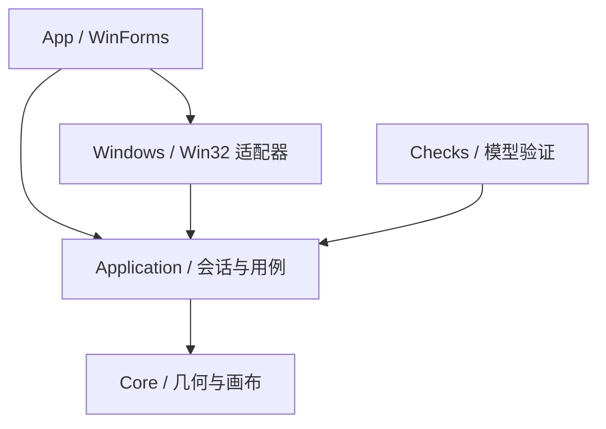

# 架构与坐标约定

状态：M1 / T01–T03 已实现，2026-10-17。真实地图通过事件增量同步；真实桌面接管相关条目是后续设计约束，不表示已经实现。

## 依赖方向

Core 不依赖 UI、Win32、文件系统或运行中的桌面。Application 维护逻辑模型并定义平台端口。Windows 负责 HWND、物理像素和 API 生命周期。App 是组合入口，负责线程与界面。当前不引入服务容器、消息总线、数据库或网络服务。

## 当前模块

| 模块 | 已实现 | 后续责任 |
| --- | --- | --- |
| Core | 有限数值几何类型、原生比例相机、小地图、PixelRect 与世界/物理坐标映射 | 空间邻接、可撤销布局策略 |
| Application | 画布/导航/书签、准入身份、显示器快照；增量事件批次、物理/世界同步与预期移动回调协议 | 管理会话、输入事务、总览选择与恢复协调 |
| Windows | HWND/进程身份、owner/style、cloak、虚拟桌面；PMv2 物理坐标与 DPI；WinEvent hooks | 批量移动、激活、DWM 预览、恢复 |
| App | 示例地图；窗口准入与显示器诊断；事件驱动的只读真实地图 | 托盘、覆盖式总览、设置与全局快捷键 |
| Checks | 61 项模型/策略检查；19 项原生窗口/显示器/事件检查 | 恢复与移动事务验证 |

当前列表区分可纳入与排除项，无法验证的状态默认排除。“可纳入”只表示可进入只读模型，不授权移动窗口；恢复日志与移动前重新验证仍是 M2 前置条件。详细顺序和边界见 [窗口身份与准入](window-discovery.md)。

T03 使用短批次按 HWND 增量读取，无持续全量轮询。destroy 在新读取前撤销旧身份，队列溢出时撤销全表并协调；交换批次避免 COM 重入丢事件。物理相机与地图预览相机分离。细节、预期移动识别协议与实测范围见[事件同步](window-lifecycle.md)。

## 坐标系统

- 世界坐标 W：Core 的 double 画布单位，无 HWND 范围约束。
- 相机坐标 C：当前视口左上角在世界中的位置；世界原点固定为 `(0,0)`。
- 视口局部坐标 V：`V = W - C`，不含实际显示器偏移。
- 小地图坐标 M：同一批矩形共用 `M = W × scale + offset`，双轴使用同一倍率。
- 桌面物理坐标 P：Win32 使用的物理屏幕像素，可包含负数显示器原点。

T02 已定义 `P = W - C + WorkArea.Position` 的原生比例映射，并以主屏工作区更新示例视口尺寸。一画布单位对应一物理像素，DPI 不参与额外内容缩放；Windows 适配器负责在 PMv2 上下文内读取物理像素。单屏 100% DPI 和负坐标规则已用模型数据验证，本机为 150% DPI；M4 前不声明支持多屏混合 DPI 接管。操作应用的“原生比例”不取消应用或系统原有 DPI 设置。完整契约、取整、Int32 边界和硬件实测范围见 [显示器与坐标](display-coordinates.md)。

几何模型拒绝 NaN、Infinity 和非正尺寸。逻辑空间不是字面上的无穷数；窗口 API 的整数范围与浮点数精度都必须检查，不允许直接把任意远的世界坐标转换为 int。

## 后续运行流程

1. 发现候选，按准入策略筛选；建立独立 Guid 身份和 HWND、PID、进程启动时间之间的绑定。
2. 接管前保存原生 placement、可见状态、尺寸、显示器和可能修改的裁剪/样式，先落盘恢复日志。
3. 用户手势改变相机；计算本帧的窗口目标位置，合并高频输入，用批量定位避免逐次 UI 阻塞。
4. 自身移动产生的 WinEvent 按预期位置、会话版本与事务编号识别；外部拖动才反写世界坐标。
5. 聚焦请求先移动相机，再请求原生激活；激活失败要反馈，不能伪称应用已经获得键盘焦点。
6. 退出、恢复快捷键或异常恢复读取日志，将仍属于原进程的窗口恢复到可操作的屏幕范围。

Win32 批量定位不视为跨进程原子事务。部分窗口拒绝移动时需记录失败，保持逻辑状态与实际状态可协调，不无限重试或拖住整个桌面。

## 总览与输入

操作模式保留真实窗口输入。导航模式临时接收画布手势。总览模式接收选择、方向导航和搜索；不向缩略图注入编辑输入。恢复模式优先结束鼠标捕获并恢复窗口。

总览打开时保存起始相机与投影范围；只改变选中项不改变工作视角，Enter/单击确认后才跳转。Esc 恢复起始视角。搜索保持原始空间坐标，不能重新布局卡片；显式适配全部窗口或总览尺寸变化时才重算投影。M0 的每帧适配仅为模型演示。

后续平移手势以一次按下—移动—释放作为一个历史事务，滚轮突发按时间窗口合并。M0 每次 PanBy 单独记录历史，上限 64；不限数量的位置书签不使用历史栈。

窗口移动/激活、全局输入、DWM 缩略图分别封装，避免把它们混在 UI Paint 或低级钩子回调里。钩子回调只识别输入并排队，预览的原生资源由 UI 所在线程管理并在关闭时释放。

## 恢复与离屏策略

屏幕外停放/裁剪方案尚未定案，必须测量它对多屏泄漏、刷新、最小化、任务栏预览和弹窗的影响。用户层面“不隐藏”表示不用隐藏/最小化/桌面切换组织空间；不能因此承诺不可见窗口持续渲染。

进程内 finally 或崩溃回调无法覆盖强制结束和掉电。真实接管前需要落盘日志、下次启动恢复及独立恢复入口；是否增加看护进程由原型结果决定。日志不能只信任 HWND，防止句柄复用后误移动其他窗口。

持久化路径预定为 `%LOCALAPPDATA%/BorderlessFlatWindow/`，使用版本化 JSON 和原子替换，尚未实现。恢复日志与常规布局分开。默认日志不记录窗口标题和文档内容；所有数据本地处理，不自动上传。

## 官方依据

- [WinForms](https://learn.microsoft.com/en-us/dotnet/desktop/winforms/overview/)
- [SetWindowPos](https://learn.microsoft.com/en-us/windows/win32/api/winuser/nf-winuser-setwindowpos)
- [窗口批量定位](https://learn.microsoft.com/en-us/windows/win32/winmsg/window-features)
- [前台激活限制](https://learn.microsoft.com/en-us/windows/win32/api/winuser/nf-winuser-setforegroundwindow)
- [DWM 实时缩略图](https://learn.microsoft.com/en-us/windows/win32/dwm/thumbnail-ovw)
