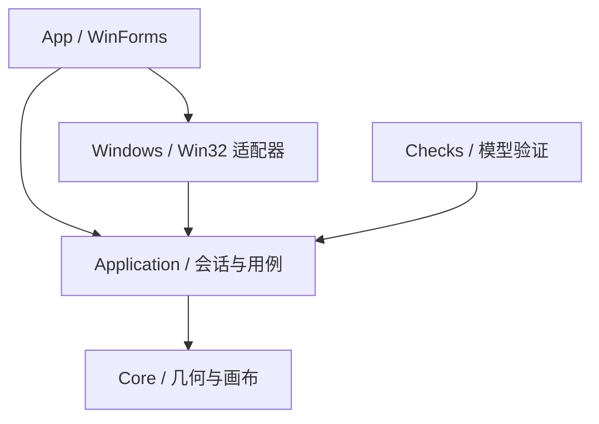

# 架构与坐标约定

状态：试用集成，2026-10-19。已有真实管理、恢复、有界停放、全局导航、总览/预览、持久化标签及新窗接入；框架依赖试用包已验证系统普通应用与包内恢复，接续物理操作验收。

## 依赖方向

Core 不依赖 UI、Win32、文件系统或运行中的桌面。Application 维护逻辑模型并定义平台端口。Windows 负责 HWND、物理像素和 API 生命周期。App 是组合入口，负责线程与界面。当前不引入服务容器、消息总线、数据库或网络服务。

## 当前模块

| 模块 | 已实现 | 后续责任 |
| --- | --- | --- |
| Core | 几何、相机、小地图、物理映射；可见投影/有界停放与邻屏检查 | 空间邻接、可撤销布局策略 |
| Application | 画布/导航、准入、事件；恢复与真实管理；手势合并；独立总览；共享位置标签；运行中登记及接入基线 | 兼容与集成验收 |
| Windows | 原生发现/事件、PMv2、DPI；标记、恢复、JSON；批次移动/激活、受身份保护的 DWM 预览；独立输入线程与快捷键 | 第三方来源兼容验证 |
| App / Recovery | 单屏管理、诊断、导航配置；空间总览与预览降级；位置标签 UI 和 JSON 原子存储；恢复页与独立入口 | 托盘与完整设置 |
| Checks / Probe | 191 项模型、15 项文件、48 项原生检查；不透明 Probe；总览、标签、新窗接入与五窗主 GUI 故障恢复 | 物理组合手势、第三方应用兼容与完整原型交互验收 |

当前列表区分可纳入与排除项，无法验证的状态默认排除。“可纳入”只表示可进入只读模型，不授权移动窗口；恢复日志与移动前重新验证仍是 M2 前置条件。详细顺序和边界见 [窗口身份与准入](window-discovery.md)。

T03 使用短批次按 HWND 增量读取，无持续全量轮询。destroy 在新读取前撤销旧身份，队列溢出时撤销全表并协调；交换批次避免 COM 重入丢事件。物理相机与地图预览相机分离。细节、预期移动识别协议与实测范围见[事件同步](window-lifecycle.md)。

## 坐标系统

- 世界坐标 W：Core 的 double 画布单位，无 HWND 范围约束。
- 相机坐标 C：当前视口左上角在世界中的位置；世界原点固定为 `(0,0)`。
- 视口局部坐标 V：`V = W - C`，不含实际显示器偏移。
- 小地图坐标 M：同一批矩形共用 `M = W × scale + offset`，双轴使用同一倍率。
- 桌面物理坐标 P：Win32 使用的物理屏幕像素，可包含负数显示器原点。

T02 已定义 `P = W - C + WorkArea.Position` 的原生比例映射，并以主屏工作区更新示例视口尺寸。一画布单位对应一物理像素，DPI 不参与额外内容缩放；Windows 适配器负责在 PMv2 上下文内读取物理像素。单屏 100% DPI 和负坐标规则已用模型数据验证，本机为 150% DPI；M4 前不声明支持多屏混合 DPI 接管。操作应用的“原生比例”不取消应用或系统原有 DPI 设置。完整契约、取整、Int32 边界和硬件实测范围见 [显示器与坐标](display-coordinates.md)。

几何模型拒绝 NaN、Infinity 和非正尺寸。逻辑空间不是字面上的无穷数；窗口 API 的整数范围与浮点数精度都必须检查，不允许直接把任意远的世界坐标转换为 int。

## 管理运行流程

1. 发现候选，按准入策略筛选；建立独立 Guid 身份和 HWND、PID、进程启动时间之间的绑定。
2. 接管前保存原生 placement、可见状态、尺寸、显示器和可能修改的裁剪/样式，先落盘恢复日志。
3. 用户手势改变相机；计算本帧的窗口目标位置，合并高频输入，用批量定位避免逐次 UI 阻塞。
4. 自身移动产生的 WinEvent 按预期位置、会话版本与事务编号识别；外部拖动才反写世界坐标。
5. 聚焦请求先移动相机，再请求原生激活；激活失败要反馈，不能伪称应用已经获得键盘焦点。
6. 退出、恢复快捷键或异常恢复读取日志，将仍属于原进程的窗口恢复到可操作的屏幕范围。

Win32 批量定位不视为跨进程原子事务。部分窗口拒绝移动时需记录失败，保持逻辑状态与实际状态可协调，不无限重试或拖住整个桌面。

T06 已实现上述接管、规划、提交、确认与暂停恢复链路。同线程原生 deferred 批次与跨线程异步请求分开；仅待确认 HWND 启用短时计时器。预期中间位置不反写世界坐标，稳定可见窗口的外部编辑才更新布局；关联弹窗与状态变化暂停恢复。详见[真实画布管理](managed-canvas.md)。

FR-02 在同一会话增加目标：纯几何扫描视口空位，先为全部新目标登记恢复日志，再提交仅新增窗口的批次。旧窗口不重新登记/规划，布局、相机、历史与标签不重建。自动接入默认关闭，启用时记录现有桌面，按 WinEvent 增量发现并等待稳定；读取重入退出会取消登记并延迟释放。详见[运行中接入](runtime-window-admission.md)。

## 总览与输入

操作模式保留真实窗口输入。导航模式临时接收画布手势。总览模式接收选择、方向导航和搜索；不向缩略图注入编辑输入。恢复模式优先结束鼠标捕获并恢复窗口。

总览打开时保存起始相机与投影范围；只改变选中项不改变工作视角，Enter/单击确认后才跳转。Esc 恢复起始视角。搜索保持原始空间坐标，不能重新布局卡片；显式适配全部窗口或总览尺寸变化时才重算投影。M0 的每帧适配仅为模型演示。

T08 已实现上述独立状态，打开期间暂停工作导航和自动前台跟随。主窗口临时承载总览，关闭时恢复边框/Bounds/标题/置顶与显示状态，使用原任务栏项；取消的原窗口身份使用独立临时 marker 验证。目标关闭从总览及暂停布局移除，确认前再读目录和身份。详见[空间总览](spatial-overview.md)。

T09 通过 Application 预览端口和有界会话管理 DWM 生命周期。目标为真正顶层主 HWND，地图客户区坐标显式换算，来源独立 marker 防止旧资源继续呈现失效目标；离屏/边缘、失败、重叠和过小卡片使用标题视图。资源获取不在绘制或输入 hook 中，原生查询重入关闭会释放迟到资源。详见[预览与降级](overview-previews.md)。

T10 的 `BookmarkCollection` 被当前管理工作区共享；`BookmarkLibrary` 经端口成功落盘后才发布增删改，显示配置重建不丢标签。Windows 标签存储独立于恢复日志，使用版本、独占租约、内容摘要和同目录原子替换；损坏文件只读并可备份重建。真实跳转通过管理会话的 Navigate 完成，标签编辑不改窗口、相机或历史。详见[位置标签](location-bookmarks.md)。

T07 已按一次双键拖动保存一个历史事务，滚轮突发以 250ms 间隔划分；UI 以 16ms 帧计时器合并输入。M0 示例仍每次 PanBy 独立记录；历史上限 64，不限数量的位置书签不使用历史栈。输入线程保持短回调、队列有界、失去 UI 心跳自动退出模式，详见[全局导航](global-navigation.md)。

窗口移动/激活、全局输入、DWM 缩略图分别封装，避免把它们混在 UI Paint 或低级钩子回调里。钩子回调只识别输入并排队，预览的原生资源由 UI 所在线程管理并在关闭时释放。

## 恢复与离屏策略

T05 选择有界停放：可见时使用真实投影，离开视口后把 native 窗口放到所有显示器外，保持世界位置和尺寸。真实 DWM 预览已观察到离屏旧帧和裁剪空白，区域裁剪仅为本进程实验；不会进入当前生产路径。规划和可视验证、任务栏 hover 未验收等边界见 [ADR 0002](adr/0002-bounded-offscreen-parking.md)。用户层面“不隐藏”表示不用隐藏/最小化/桌面切页组织空间，不承诺离屏持续渲染。

T04 已实现写前日志、下次启动提示和独立恢复 EXE。pending 日志先落盘，设置随机实例标记并复验，再保存 armed；只有当前标记和身份匹配的 armed 条目能授权移动。正常 Dispose 恢复新会话，旧会话必须显式恢复；部分失败保留记录并阻断后续移动。详见[恢复协议与验证](recovery.md)。进程内 finally 不能覆盖强制结束，独立程序与持久日志已通过强制结束演练。

试用发布将 GUI、Recovery 和 Probe 分别框架依赖发布为 win-x64，校验共享文件一致后放在同一目录。GUI 优先调用相邻恢复 EXE；manifest 记录源码状态和 SHA-256，数据仍在 LocalAppData。损坏日志在 GUI 受控显示并自动进入恢复页；UI 冒烟使用独立 fixtures，不读取默认真实日志。详见[试用验证](trial-validation.md)。

恢复日志位于 `%LOCALAPPDATA%/BorderlessFlatWindow/recovery.json`，已实现版本化 JSON、原子替换、flush 和 OS 文件租约；T10 标签独立持久化，窗口世界布局仍仅本次进程保留。日志不记录标题或文档内容，所有数据本地处理。当前只恢复 placement 和显示状态；若后续离屏策略修改区域或样式，必须先扩展恢复协议及测试。

## 官方依据

- [WinForms](https://learn.microsoft.com/en-us/dotnet/desktop/winforms/overview/)
- [SetWindowPos](https://learn.microsoft.com/en-us/windows/win32/api/winuser/nf-winuser-setwindowpos)
- [窗口批量定位](https://learn.microsoft.com/en-us/windows/win32/winmsg/window-features)
- [前台激活限制](https://learn.microsoft.com/en-us/windows/win32/api/winuser/nf-winuser-setforegroundwindow)
- [DWM 实时缩略图](https://learn.microsoft.com/en-us/windows/win32/dwm/thumbnail-ovw)
