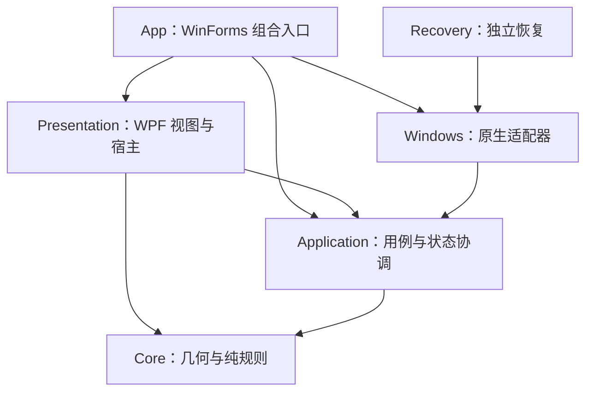

# 当前架构与不变量

当前为 Windows 原生便携试用版。用户入口见 [README](../README.md)，验证边界见[检查分层](testing.md)及[正式版验收](release-v1-readiness.md)。迭代过程归档于 [history](history/README.md)，不作为当前默认行为说明。

## 项目与依赖

| 目录 | 职责与边界 |
| --- | --- |
| `src/BorderlessFlatWindow.Core` | 世界坐标、相机、布局与纯规则；不依赖桌面、UI 或文件系统 |
| `src/BorderlessFlatWindow.Application` | 会话、准入、导航、书签、恢复协议、端口及启动/交互协调；仅引用 Core |
| `src/BorderlessFlatWindow.Windows` | HWND 身份、WinEvent、独立输入线程、DWM 预览、物理移动、本地 JSON 存储 |
| `src/BorderlessFlatWindow.Presentation` | 共享 WPF 空间视图、原生顶层窗口与 WinForms 嵌入适配 |
| `src/BorderlessFlatWindow.App` | 组装端口、托盘与面板，分派命令，绑定视图；不编译实验或 UI 断言 |
| `src/BorderlessFlatWindow.Recovery` | 无主界面依赖的独立恢复入口 |
| `tests` | 模型、存储、原生及 UI 检查；App.Checks 以源链接编译同一份界面源码与私有 partial 夹具，不复制生产实现 |
| `tools/BorderlessFlatWindow.Lab` | 触控实验、原生表面实验和负载基准，引用正式 App，不随用户包发布 |

`scripts/check-project-structure.ps1` 在检查入口验证引用无环、可移植层边界及实际 MSBuild 编译清单，防止检查/实验代码重新进入 App 或 Presentation。Windows 中少量受 `nativeInput == false` 保护的内部输入接缝供隔离 worker 检查使用；它们不安装真实钩子。

## 状态与线程所有权

- `ManagedCanvasSession` 拥有世界布局、相机、历史、目标登记、确认和恢复状态；UI 不直接改写窗口原生状态。
- `CanvasInteractionState` 统一面板、全局输入和系统切换资格。短暂目录读取/移动事务延后 UI 命令，不撤销已运行输入；显式编辑、恢复、系统切换和无效显示配置阻断输入。
- `CanvasLaunchCoordinator` 保留一次启动请求，等待临时 UI 边界结束；不会覆盖手动暂停、待恢复或系统切换。零窗口与全部窗口已最小化时仍可开始空画布，后续自动接入普通窗口。
- `NavigationModeCoordinator` 拥有待进入触控的代号；取消、重开后的旧回调不能消费新请求。输入线程继续拥有鼠标/键盘路由、触控接收窗口和准星的原生生命周期。
- 总览请求、准备资源和输入会话各有代号/所有权；只在核验快照匹配后转移资源。取消、晚到创建和焦点回落不能复活旧总览。
- 低级输入回调与 WinEvent 只做短处理/排队；UI 消息循环合并移动和协调目录，原生 COM 查询允许重入，提交后必须复验。

## 运行行为

正常启动在设置、事件监听、显示和输入初始化就绪后自动开始，并默认纳入已有及后续可用普通窗口。用户暂停、系统变化后的安全暂停和恢复完成后保持停止，需明确开始；损坏设置、待恢复记录和权限失败不自动绕过。

桌面空白处滚轮、Shift/水平滚轮、双键拖动和边缘推进移动相机；进入应用后交还点击/滚动。触控导航只接管双轴滚动，应用点击、拖动及双指右键按上下文放行；准星模式独立处理位移。桌面 Tab/Shift+Tab 总览；完整键位与限制见[使用指南](trial-guide.zh-CN.md)。

主面板为托盘弹窗，设备诊断提供窗口、显示器和地图三个子页。开发用空间示例不出现在正常导航中。工作区是保存的相机位置，不隐藏其他窗口；仅列用户保存项，不附加默认“原点”，Home 仍返回原点。

Windows 11 build 22621 起默认使用原生 WPF 顶层总览；较早系统或 `--form-overview` 使用兼容宿主。两者复用 `SpatialOverviewView`，不是两套地图布局实现。`IOverviewPresenter` 隔离句柄、显示/关闭和预览资源生命周期；保留兼容路径直至支持矩阵允许退役。

## 坐标、移动与恢复不变量

- 世界坐标使用有限 double；视口坐标 `V = W - C`，原生物理坐标 `P = W - C + CanvasWorkArea.Position`。地图对全部窗口共用统一倍率。
- 同 DPI 多屏共享连续画布，屏间空隙不是可见工作区；混合 DPI 仍不接管。背景和任务栏不随相机移动。
- 离屏窗口按有界策略停放，世界坐标不被停放位置覆盖。不会承诺离屏预览一直刷新，见 [ADR 0002](adr/0002-bounded-offscreen-parking.md)。
- 接管前持久化原始 placement 并绑定 HWND/PID/创建时间和实例标记，成功登记后才允许移动；批量定位不是跨进程原子事务。
- 目标关闭逐窗清理，隐藏/最小化局部挂起并保留世界位置；最后一窗关闭或最小化不会结束画布。其余状态缺口以验收清单为准。
- 正常暂停/退出与独立恢复共用协议；部分失败保留记录。损坏或未确认的日志不是可清除缓存。窗口世界布局只在本进程保留，书签和设置独立持久化。

## 构建与分发

版本由根目录 [Version.props](../Version.props) 提供；程序保留提交 SHA，包清单记录同一版本、源码、运行时及每个文件的哈希。用户包只发布 App、Recovery、Probe 和所需运行时/指南/许可，不发布 App.Checks 或 Lab。

便携验证分别检查实际 App 的运行时初始化，以及临时 UI 宿主对包内生产依赖和独立恢复 EXE 的验证；临时宿主不等同于正式 App 二进制，也不进入 ZIP。完整流程见[部署](deployment.md)及 [ADR 0003](adr/0003-isolated-ui-validation.md)。
